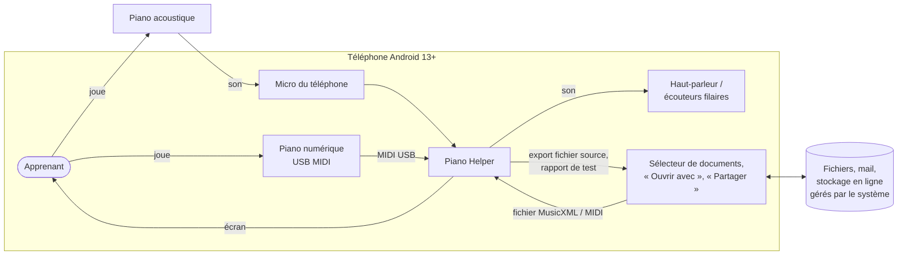
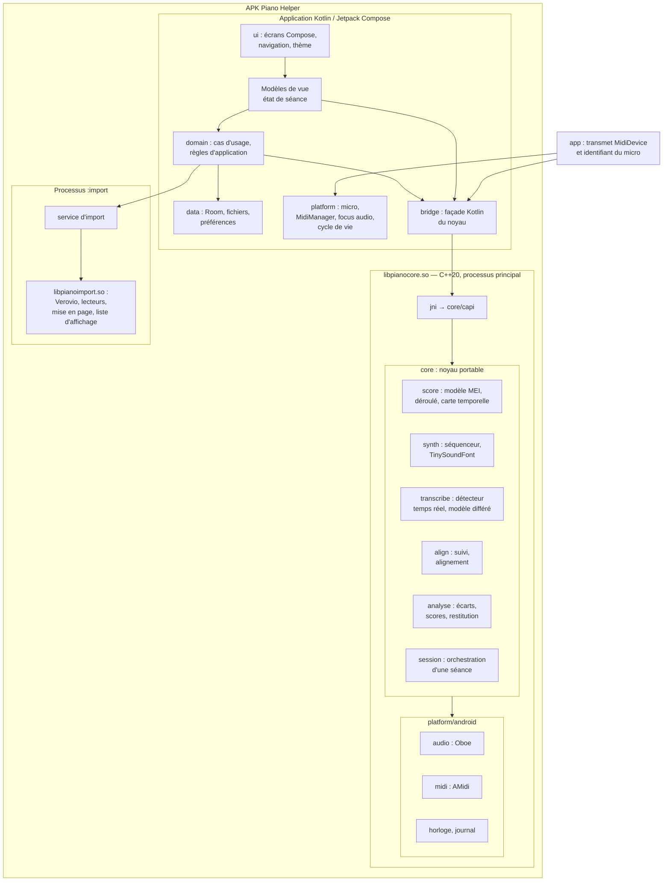

# 02 — Vue d'ensemble

## 1. Vue de contexte

Au MVP, l'application est **seule sur le téléphone** : aucun serveur, aucune connexion réseau (ENF-OFF-01, ENF-CONF-03). Ses seuls échanges passent par le système Android, à l'initiative de l'utilisateur.

| Acteur ou système | Échange | Exigences |
|---|---|---|
| Apprenant | Touchers, jeu, lecture de l'écran à 60 cm | ENF-ACC-01, ENF-ACC-07 |
| Micro du téléphone | Signal audio, seulement en séance ou au réglage du micro | EF-ECO-04, ENF-SEC-06 |
| Piano numérique en USB | Messages MIDI (testés par simulation, R-16) | EF-ECO-02 |
| Sélecteur de documents et partage du système | Import de fichiers, export du fichier source et du rapport de test | EF-IMP-05, EF-BIB-03, ENF-MAINT-04 |
| Sauvegarde Android | **Désactivée** | ENF-CONF-01, QO-36 |
| Internet | **Aucun accès** (pas de permission) | ENF-CONF-03 |

Hors de l'application, sur l'ordinateur du porteur et dans l'intégration continue : le **banc d'évaluation**, le **corpus** et les **scripts** ([§4](#4-outils-hors-application)).

## 2. Conteneurs et modules

| Conteneur | Technologie | Responsabilité | Ne fait pas |
|---|---|---|---|
| Application Kotlin | Kotlin 2.4, Jetpack Compose, Room, coroutines | Écrans, navigation, état, persistance, autorisations, cycle de vie, appels au noyau | Aucun traitement du signal ni règle d'analyse |
| `libpianocore.so` | C++20, CMake | Modèle de partition (lecteur MEI), synthèse, captation, transcription, alignement, analyse, scores | Aucune interface, aucune persistance durable ; **ne contient pas Verovio** |
| `libpianoimport.so` | C++20, CMake, Verovio | Lecture des fichiers non fiables, conversion en MEI, mise en page, liste d'affichage ([ADR-0023](adr/0023-deux-bibliotheques-natives.md)) | Chargée seulement dans le processus `:import` |
| Service d'import (processus `:import`) | Même APK ; processus privé, même UID ([ADR-0021](adr/0021-import-en-processus-isole.md)) | Confine les plantages et le manque de mémoire de l'import | Écriture dans la base ; ce n'est pas un bac à sable de sécurité (DA-16) |
| Variante interne seulement | Kotlin | Simulateur MIDI (appareil virtuel), clavier visuel, enregistreur de séance, instrumentation de mesure (US-QUA-03, US-QUA-05) | Absente des variantes bêta et publique (C-T8) |

**Règle de dépendance.** `core` ne dépend que de la bibliothèque standard C++ et de bibliothèques tierces portables ; tout accès à la plateforme passe par des interfaces (`AudioIO`, `MidiInput`, `Clock`, `Logger`) implémentées dans `platform/android` et, pour le banc, dans `platform/host` ([03 §2](03-noyau-natif.md#2-découpage-et-dépendances)). C'est ce qui rend le noyau testable sur ordinateur (ENF-MAINT-01) et portable sur iOS (ENF-COMP-01). Décision : [ADR-0001](adr/0001-decoupage-application-noyau-outils.md).

## 3. Répartition des responsabilités entre Kotlin et C++

| Sujet | Kotlin | C++ | Raison |
|---|---|---|---|
| Découverte et ouverture d'un appareil MIDI | ● | | L'API NDK AMidi exige un objet Java `MidiDevice` ouvert par `MidiManager` [VÉRIFIÉ 2026-11-07, developer.android.com/ndk/guides/audio/midi] |
| Lecture des messages MIDI | | ● | `AMidiOutputPort_receive` en natif : pas de passage par la machine virtuelle |
| Autorisation du micro, focus audio, routage | ● | | API Android |
| Flux audio entrée et sortie | | ● | Oboe, temps réel (C-T1) |
| Import, modèle, déroulé, carte temporelle | | ● | Portabilité et cohérence entre lecture, affichage et analyse |
| Mise en page (gravure) | | ● | Verovio |
| Dessin à l'écran | ● | | Compose Canvas, à partir de la liste d'affichage produite par le noyau ([ADR-0007](adr/0007-affichage-liste-d-affichage-compose.md)) |
| Machine à états de l'écran de séance (pause, interruption) | ● | ● | L'application décide d'après le cycle de vie Android ; le noyau décide d'après le jeu (pause après silence, reprise en jouant) |
| Persistance | ● | | Room ([ADR-0014](adr/0014-persistance-room-et-fichiers.md)) |
| Textes affichés, langues | ● | | Ressources Android (ENF-I18N-01) ; le noyau ne produit que des codes |

## 4. Outils hors application

| Outil | Technologie | Rôle | Où il tourne |
|---|---|---|---|
| **Banc d'évaluation** (`tools/bench`) | C++ (même code que `core`) | Rejouer le corpus, calculer les métriques, appliquer la règle de non-régression (US-QUA-02) | CI (corpus public), ordinateur du porteur (corpus privé), téléphone (corpus micro injecté, US-QUA-02 CA5) |
| **Générateur d'erreurs** (`tools/bench`) | C++ | Injecter des erreurs dans des MIDI de référence (US-QUA-01) | Ordinateur, CI |
| **Corpus** | Fichiers versionnés (MusicXML, MIDI, FLAC, annotations JSON) | Vérité terrain | Dépôt séparé `piano-helper-corpus` (public, CC0 ; fichiers audio joints à ses versions, décision QO-49) ; hors dépôt (privé) |
| **Scripts de contrôle** (`tools/scripts`) | Node.js | Cohérence de la documentation (identifiants, liens), notes de version, contrôles de l'APK | Ordinateur, CI |
| **Prototypes MIR** (`tools/poc`) | Python 3 dans WSL 2 (venv), prérequis à installer (décision QO-48) | POC-01 : référence Basic Pitch, conversion de modèles, métriques `mir_eval` pour valider l'implémentation C++ | Ordinateur seulement, jamais dans l'APK ni dans la CI bloquante |
| **Prototype HTML de QO-27** | Page HTML locale et Verovio JavaScript (npm) | Test d'affichage au pupitre fait par le porteur ([PRD 09](../PRD/09-decisions-a-prendre.md)) | Navigateur du téléphone |

Python est limité aux prototypes : le banc qui garde la porte (ENF-QA-02) est en C++, pour garantir que l'on mesure **le code qui tourne sur le téléphone** et pour ne pas imposer Python dans la CI.

## 5. Vue de déploiement

| Élément | Emplacement | Remarque |
|---|---|---|
| APK (variante bêta ou publique) | Téléphone, installé depuis la page de publication du dépôt (QO-20) | ABI : `arm64-v8a` seulement ; `x86_64` dans la variante interne (émulateur) (décision QO-47) |
| Bibliothèques natives | `lib/arm64-v8a/` : `libpianocore.so`, `libpianoimport.so`, `libc++_shared.so` | Verovio est lié **statiquement** dans `libpianoimport.so` ; la LGPL est respectée par la publication des sources complètes ([09 §5](09-securite-confidentialite-licences.md#5-inventaire-des-composants-et-compatibilité), JUR-D04) |
| Ressources embarquées | `assets/` : données de Verovio (Bravura, Leipzig, texte), extraites vers le stockage interne au premier import ; banque de sons SF2 ; modèle de transcription si POC-01 en retient un ; démonstrations ; textes des licences | Pas de téléchargement au MVP (pas de réseau) |
| Données de l'utilisateur | Stockage interne de l'application (`filesDir`, base Room) | Exclues de toute sauvegarde ([06 §8](06-donnees-et-stockage.md#8-sauvegarde-android-désactivée)) |
| Banc, corpus, scripts | Dépôt git et CI | Jamais dans l'APK |

## 6. Dépendances entre modules et incréments

| Incrément | Modules du noyau mis en œuvre | Modules de l'application |
|---|---|---|
| I0 | `bench`, `score` (lecture du corpus), `analyse` prototype (POC-05) | Squelette, écran « À propos » et licences (US-CNF-02) |
| I1 | `score`, `render`, `synth`, `session` (lecture) | Bibliothèque, import, partition, lecture |
| I2 | `align`, `analyse`, `session` (pratique MIDI), `platform/android/midi` | Préparation de séance, mode attente et jeu continu, compte-rendu |
| I3 | `transcribe` (temps réel), `platform/android/audio` (entrée) | Autorisation du micro, réglage, indicateur de signal |
| I4 | — | Profil, historique, migrations, import MIDI (noyau `score/midi`) |
| I5 | `transcribe` (différé pour le jeu continu) | Jeu continu au micro, boucle |
| I6 | — | Rapport de test, notice de confidentialité |
