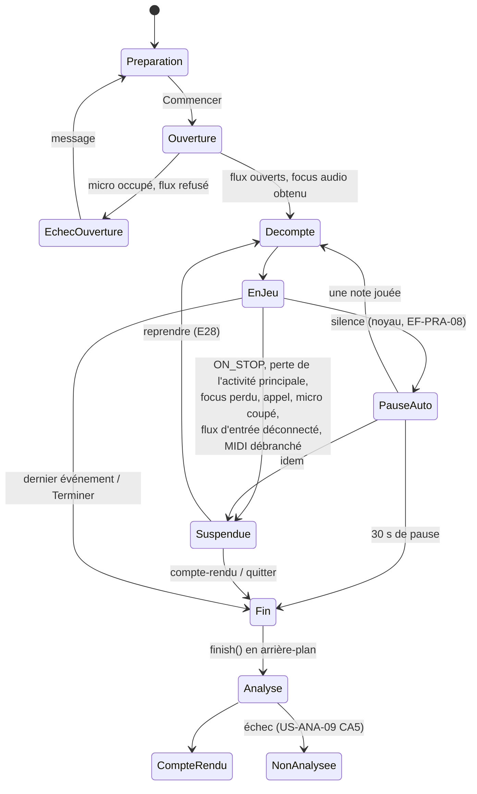

# 04 — Application Android

## 1. Socle

| Élément | Choix | Source et date |
|---|---|---|
| Langage | Kotlin 2.4.21 | kotlinlang.org/docs/releases.html [VÉRIFIÉ 2026-11-07] |
| Interface | Jetpack Compose, BOM 2026.09.00 (`ui` 1.12.1, `material3` 1.4.0) | developer.android.com/develop/ui/compose/bom/bom-mapping [VÉRIFIÉ 2026-11-07] |
| Persistance | Room 2.8.5 (SQLite) | developer.android.com/jetpack/androidx/releases/room [VÉRIFIÉ 2026-11-07] |
| Sérialisation | kotlinx.serialization 1.12.0 (JSON) | github.com/Kotlin/kotlinx.serialization [VÉRIFIÉ 2026-11-07] |
| Concurrence | Coroutines Kotlin (`kotlinx.coroutines`, Apache-2.0) | Inventaire : [09 §5](09-securite-confidentialite-licences.md#5-inventaire-des-composants-et-compatibilité) |
| `minSdk` / `targetSdk` / `compileSdk` | 33 / 36 / 37 | Android 17 (API 37) publié le 2026-06-16 ; Google Play exige `targetSdk` ≥ 36 depuis le 2026-08-31 [VÉRIFIÉ 2026-11-07] |
| Injection de dépendances | Manuelle (conteneur d'application) | Évite une technologie de plus (K6) |

Pas de services Google Play, pas de Firebase, pas de bibliothèque d'analyse d'audience (US-CNF-01 CA4).

**Comportements imposés par `targetSdk` 36** [VÉRIFIÉ par `dev-android` le 2026-11-08, developer.android.com/about/versions/16/behavior-changes-16] :
- affichage **bord à bord** obligatoire : commandes de séance et bande placées selon `WindowInsets.safeDrawing`, `displayCutout` et `systemGestures` (DA-09) ;
- **retour prédictif** actif : le retour est géré par `BackHandler` / `PredictiveBackHandler` ; en séance, retour = suspension puis écran E28, jamais une sortie silencieuse (DA-09) ;
- sur les écrans de **largeur minimale ≥ 600 dp**, le système ignore le verrouillage d'orientation et les limites de redimensionnement ; la dérogation disparaît avec `targetSdk` 37 (DA-01). Voir §4.

## 2. Couches et modules

| Module Gradle | Contenu | Dépend de |
|---|---|---|
| `:app` | Activité unique, navigation, thème, conteneur, variantes interne / bêta / publique ; transmet au pont le `MidiDevice` et l'identifiant du micro | tous |
| `:feature:library`, `:feature:score`, `:feature:practice`, `:feature:report`, `:feature:settings`, `:feature:about` | Écrans Compose et modèles de vue | `:domain`, `:bridge` (exception temps réel : `:feature:practice → :bridge`, DA-20) |
| `:domain` | Cas d'usage, règles d'application, **interfaces de dépôt** | — (Kotlin pur) |
| `:data` | Room, fichiers, préférences : implémente les dépôts de `:domain` | `:domain` |
| `:platform` | Autorisation du micro, focus audio, mode audio, routage, `MidiManager`, cycle de vie | Android |
| `:bridge` | Façade Kotlin de `core/capi`, chargement de `libpianocore.so`, `ensureLoaded()` | — |
| `:tools` (variante interne seulement) | Appareil MIDI virtuel, clavier visuel, enregistreur de séance, instrumentation | `:bridge` |

`:platform` et `:bridge` ne dépendent pas l'un de l'autre (DA-20) ; `:domain` reste pur pour un passage ultérieur à Kotlin Multiplatform ([11](11-portabilite-ios.md)).

**Démarrage à froid (ENF-PERF-09).** L'écran d'accueil ne charge que Room. `libpianocore.so` est chargée en arrière-plan juste après le premier affichage ; tout appel natif attend `ensureLoaded()` (DA-19). `libpianoimport.so` n'est jamais chargée dans le processus principal ([ADR-0023](adr/0023-deux-bibliotheques-natives.md)).

**Processus.** `Application.onCreate` s'exécute dans chaque processus : il teste `Application.getProcessName()` ; dans le processus `:import`, il n'initialise que le service d'import (ni Room, ni ménage du démarrage) (DA-16).

## 3. Navigation

Pas de barre de navigation au MVP ; la bibliothèque est l'écran d'accueil. Activité unique et Navigation Compose. L'écran de séance garde l'écran allumé (`FLAG_KEEP_SCREEN_ON`) et verrouille l'orientation **sur téléphone seulement** (§4).

## 4. État et changements de configuration

- Modèle de vue par écran, état d'écran en `StateFlow` immuable (pause, fin, erreurs).
- **Propriété de la séance** (DA-02) : la poignée native appartient à un **contrôleur de séance de portée application**, jamais à l'activité. Les événements de cycle de vie sont ignorés quand `isChangingConfigurations` est vrai.
- **Recréations évitées** : l'activité unique déclare `android:configChanges="orientation|screenSize|smallestScreenSize|screenLayout|uiMode|density|fontScale|keyboard|keyboardHidden|navigation"` ; Compose recalcule la mise en page sans recréation. `SavedStateHandle` reste utilisé pour la mort du processus. (Liste exacte des valeurs à valider à l'implémentation [NON VÉRIFIÉ].)
- **Rotation et redimensionnement en séance** (DA-01) : l'écran de séance survit à une rotation et à un redimensionnement **sans suspendre la séance** (disposition portrait et paysage sur tablette). Sur téléphone (< 600 dp), l'orientation est verrouillée. US-VIS-07 CA3 est donc à reformuler pour les tablettes (NI-1, [fichier 15](15-modifications-edb-prd-proposees.md)).
- **Données de chaque image** (DA-08) : le sondage du noyau se fait dans la **couche d'interface** (effet rattaché au composable de séance) par `Choreographer.postVsyncCallback`, **reposté à chaque image** et retiré à l'arrêt ; il donne l'instant de présentation prévu (`FrameTimeline.getExpectedPresentationTimeNanos()`, API 33). Le résultat est écrit dans un état observable par Compose, **lu seulement en phase de dessin** (`Canvas`, `drawWithContent`, lambda de `graphicsLayer`) : pas de recomposition ni de mise en page à chaque image, pas de `StateFlow` pour ces données. POC-02 mesure que la décision s'affiche à l'image suivante.

## 5. Permissions

| Permission ou fonction | Déclarée | Pourquoi | Exigences |
|---|---|---|---|
| `RECORD_AUDIO` | Oui, demandée **au premier choix du micro** | Captation micro | EF-ECO-05, US-ECO-03 |
| `INTERNET`, `ACCESS_NETWORK_STATE` | **Non** ; retirées du manifeste fusionné par `tools:node="remove"` | Aucun réseau au MVP | ENF-CONF-03 |
| Stockage, notifications, Bluetooth | Non | Import par le sélecteur de documents ; aucune notification ; détection des sorties Bluetooth par `AudioManager.registerAudioDeviceCallback` sans permission (DA-29) | US-IMP-03 CA6, US-ECO-03 CA1 |
| `FOREGROUND_SERVICE*` | Non | La séance n'existe qu'au premier plan (DA-12) | ENF-FIA-04 |
| Permissions de signature propres à l'application (ex. `<applicationId>.DYNAMIC_RECEIVER_NOT_EXPORTED_PERMISSION` d'AndroidX) | Ajoutées par les bibliothèques | Acceptées par motif dans le contrôle de l'APK (DA-24) | — |
| `uses-feature` MIDI, hôte USB, micro | `required="false"` | Installable sans MIDI ni micro | EF-ECO-01 |

**Service de premier plan (pour mémoire, DA-12).** Une séance écran éteint (hors MVP) demanderait un service de type `microphone`, les permissions `FOREGROUND_SERVICE` et `FOREGROUND_SERVICE_MICROPHONE`, un démarrage seulement quand l'application est visible, une notification (donc `POST_NOTIFICATIONS`) : toute évolution demandera une ADR.

**Autorisation du micro.** Écran explicatif avant la demande (US-ECO-03 §8.1) ; refus géré sans insister (JUR-18) ; refus définitif détecté par `shouldShowRequestPermissionRationale` faux après une demande, puis guide vers les réglages (US-ECO-03 CA4). Aucune API ne signale une autorisation « uniquement cette fois » : un indicateur « micro accordé lors de la dernière séance » sert d'heuristique pour le bandeau de US-ECO-03 CA5 (DA-10).

## 6. Cycle de vie d'une séance et interruptions

| Évènement | Détection | Effet | Exigences |
|---|---|---|---|
| Application plus visible | `Lifecycle.ON_STOP` | Suspension, micro fermé, flux de sortie fermé, point de reprise | ENF-FIA-04, ENF-SEC-06, DA-03, DA-11 |
| Perte de la position d'activité principale (écran partagé, fenêtre flottante, autre application au premier plan) | `onTopResumedActivityChanged(false)` (API 29) ; en multifenêtre, les activités visibles restent `RESUMED` | Suspension (règle du MVP, conforme à US-PRA-06 CA1 ; voir NI-2) | DA-03 |
| `ON_PAUSE` seul (activité transparente au-dessus, volet de notifications) | — | **Pas de suspension** | DA-03 |
| Changement de configuration | `isChangingConfigurations` | Aucun effet sur la séance | DA-02 |
| Focus audio | La séance **demande le focus** à son début (y compris au micro sans son) et le libère à la fin. `LOSS` ou `LOSS_TRANSIENT` → suspension ; `LOSS_TRANSIENT_CAN_DUCK` → rien | US-LEC-02 CA4, US-ECO-11 CA5, DA-04 |
| Appel entrant ou en cours | `AudioManager.addOnModeChangedListener` (API 31) : `MODE_RINGTONE`, `MODE_IN_CALL`, `MODE_IN_COMMUNICATION` → suspension, sans `READ_PHONE_STATE` | US-PRA-06 CA1, DA-04 |
| Micro coupé par le système (appel, assistant vocal, application prioritaire, bascule de confidentialité) | `AudioManager.registerAudioRecordingCallback` et `AudioRecordingConfiguration.isClientSilenced()`, plus détection de silence numérique en ≤ 3 s | Suspension et explication | US-ECO-04 CA5, DA-04 |
| Autorisation du micro retirée | Le système **termine le processus** [VÉRIFIÉ par `dev-android`, developer.android.com/training/permissions/requesting] | Au lancement suivant : séance `en_cours` → `interrompue` (dernier point de reprise), explication du texte de US-ECO-03 CA3 (NI-3) | US-ECO-03 CA6, DA-05 |
| Flux d'entrée déconnecté | Événement `StreamRestarted` du noyau | Suspension et message | DA-06, DN-08 |
| Flux de sortie déconnecté | `StreamRestarted` | Réouverture transparente, recalage de la correspondance position → temps ; avertissement si le nouvel appareil est Bluetooth | DA-06 |
| Sortie Bluetooth détectée | `registerAudioDeviceCallback` : `TYPE_BLUETOOTH_A2DP`, `TYPE_BLE_HEADSET`, `TYPE_BLE_SPEAKER`, `TYPE_BLE_BROADCAST`, `TYPE_HEARING_AID` | Avertissement de latence ; métronome sonore désactivé en jeu continu | US-ECO-11 CA3, DA-29 |
| Appareil MIDI débranché | `MidiManager` (callback par transport) | Suspension, notes relâchées | US-ECO-02 CA3 |
| Arrêt du processus | — | Au retour, séance « interrompue » depuis le dernier point de reprise ; un écran de séance restauré sans séance native mène à E28 « séance interrompue » ou au compte-rendu partiel | US-PRA-06 CA3, DA-07 |

**Points de reprise** (DA-07). Toutes les deux mesures complètes, à chaque suspension et sur `ON_STOP`, l'instantané publié par le noyau ([03 §3.6](03-noyau-natif.md#36-suivi-temps-réel-et-séance)) est écrit dans Room, en une transaction, depuis une **portée de coroutine de l'application** (pas `viewModelScope`, annulée à la destruction du modèle de vue). Le ménage qui passe les séances `en_cours` à `interrompue` est fait **une fois**, au démarrage du processus principal, avant toute création de séance.

**Flux de sortie hors premier plan** (DA-11) : fermé et lecture en pause sur `ON_STOP`, rouvert sur `ON_START` si une partition est affichée. Android 17 rend muets la lecture et le focus audio sans activité visible ni service de premier plan [VÉRIFIÉ par `dev-android`, developer.android.com/about/versions/17/changes/bg-audio].

**Mémoire basse** (DA-25) : les niveaux `TRIM_MEMORY_RUNNING_*` ne sont plus fiables ; les caches sont bornés par conception (nombre de tuiles en mémoire, liste d'affichage mappée) ; `TRIM_MEMORY_UI_HIDDEN` libère à la sortie de l'écran.

**Ne pas déranger** (DA-28) : modifier ce mode exige `ACCESS_NOTIFICATION_POLICY` ; l'application propose seulement d'ouvrir le réglage du système (proposition de modification de US-ECO-11 CA5 au [fichier 15](15-modifications-edb-prd-proposees.md)).

## 7. Pont JNI

Décision : [ADR-0003](adr/0003-pont-jni-et-echanges.md). La façade C est dans `core/capi/` ; `jni/` ne fait que traduire (DN-15).

| Type d'échange | Mécanisme | Exemples |
|---|---|---|
| Commandes peu fréquentes | Appels JNI vers `core/capi`, poignées opaques `Long`, codes d'erreur | Créer, démarrer, suspendre une séance |
| Données non temps réel | JSON en **`ByteArray` UTF-8 standard** (pas `NewStringUTF`, qui utilise l'UTF-8 modifié, DA-19), décodé par kotlinx.serialization | Rapport d'import, résultat de séance |
| Liste d'affichage | Fichier binaire en cache, mappé en mémoire | Rendu |
| Événements temps réel | `pollUiEvents` copie des enregistrements de taille fixe dans un `ByteBuffer` direct **alloué une fois**, `ByteOrder.nativeOrder()`, en-tête versionné {version, type, taille}, aligné sur 8, petit-boutiste ; adresse obtenue une fois par `GetDirectBufferAddress` à l'ouverture (DN-14) | Curseur, validation, marque, état du signal, `StreamRestarted` |
| Rappels du noyau vers Kotlin | **Aucun** | — |

**Durée de vie** (DA-19, DN-14) : fermeture idempotente ; appels concurrents interdits et documentés ; `Cleaner` Kotlin en filet de sécurité ; ordre imposé : arrêter le sondage, puis `finish()` sur un fil d'arrière-plan, puis libérer la poignée. Le format des enregistrements est décrit une fois et testé dans les deux sens (C++ ↔ Kotlin).

## 8. Variantes de construction

| Variante | Contenu | ABI | Signature | Diffusion |
|---|---|---|---|---|
| `interne` | Application + `:tools` ; code natif construit avec `-DPIANO_INTERNAL_TOOLS=ON` (enregistreur, injection de fichiers) ; identifiant suffixé `.interne` | `arm64-v8a`, `x86_64` | Clé de débogage | Jamais diffusée ; installée par ADB |
| `beta` | Sans outils ; code natif construit avec `-DPIANO_INTERNAL_TOOLS=OFF` | `arm64-v8a` (QO-47) | Clé de diffusion pérenne | Page de publication du dépôt |
| `publique` | Identique à `beta` | `arm64-v8a` | Clé de diffusion | Canal choisi avant la V1 |

Contrôles automatiques sur chaque APK bêta et public ([10 §4](10-build-ci-et-distribution.md#4-intégration-continue)) : aucune classe de `:tools` ; **aucun symbole de l'enregistreur ni de dr_wav dans les `.so`** (`llvm-nm -D`, DA-23) ; permissions selon liste blanche et liste noire (DA-24) ; `allowBackup="false"` et règles d'extraction complètes (DA-13) ; ABI autorisées ; alignement 16 Ko ; taille.

**Appareil MIDI virtuel** (variante interne, DA-22) : `MidiDeviceService` déclaré seulement dans le manifeste de `:tools`, avec la permission `android.permission.BIND_MIDI_DEVICE_SERVICE`, le filtre `android.media.midi.MidiDeviceService` et la métadonnée `device_info`. Le débranchement simulé se fait en désactivant le composant (`setComponentEnabledSetting`) [NON VÉRIFIÉ, prototypé en I0] ; à défaut, il est simulé dans `:platform` et la limite est notée à US-QUA-03 CA2.

**Lien vers les sources** (JUR-D13) : l'URL des sources de la version installée (`…/tree/vX.Y.Z`) est générée depuis `versionName` dans `BuildConfig` et affichée dans « À propos ».
