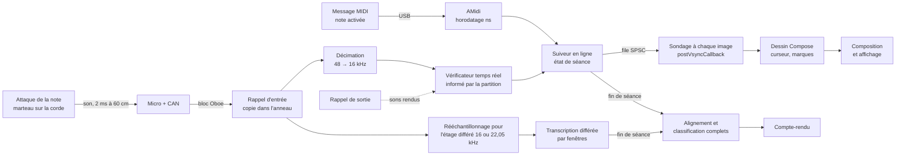
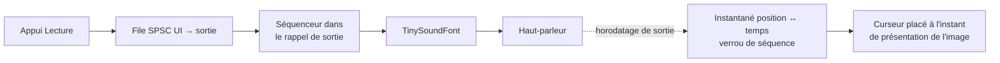

# 05 — Flux temps réel et performance

## 1. Chaîne de traitement en séance

Le chemin **temps réel** sert au mode attente et au retour en direct ; le chemin **différé** produit le compte-rendu du jeu continu, qui fait foi (EF-ANA-13). En mode attente, le différé est facultatif et ne peut que rendre une décision incertaine, jamais créer une erreur (décision QO-52, [fichier 14](14-decisions-a-prendre.md)). La fréquence d'entrée de l'étage différé dépend de l'approche retenue par POC-01 (MIR-15).

## 2. Lecture (synthèse) et curseur

## 3. Budgets de latence par étape

Les budgets sont des **objectifs de conception** ; seules les mesures du POC-02 et de US-QUA-04 font foi.

**Point de départ** ([ADR-0024](adr/0024-mesure-des-latences.md), MIR-05) : au micro, **l'attaque acoustique** (choc du marteau sur la corde) ; en MIDI, l'émission du message de note, qui a lieu vers la fin de la course de la touche. Mesurée depuis le doigt, la cible serait hors d'atteinte pour un jeu doux, l'enfoncement de la touche jusqu'au choc durant de 25 à 160 ms environ [source citée par `expert-audio-mir` : Askenfelt et Jansson, JASA 1991]. L'EDB écrit « de l'appui sur la touche » : modification proposée (INC-11, [fichier 15](15-modifications-edb-prd-proposees.md)).

**Statistique** (MIR-04) : additionner les 95e centiles de chaque étape **surestime** le 95e centile du total (E6, l'attente de l'image, est uniforme entre 0 et une période). Les tableaux ci-dessous sont des bornes prudentes ; la décision de passage se fait sur le 95e centile **du total mesuré** (ou de la convolution des distributions mesurées).

### 3.1 ENF-PERF-01 — mode attente

| Étape | MIDI | Micro | Qui la mesure | Remarque |
|---|:-:|:-:|---|---|
| E1 Propagation du son (60 cm) | — | 2 | Calcul | |
| E2 Latence d'entrée **non couverte par l'horodatage d'entrée** | 10 | ≈ 0 | POC-02 (test de cohérence clic sortie → micro, MIR-06) | L'horodatage d'AAudio inclut déjà la latence d'entrée connue du système : on ne l'ajoute pas une seconde fois. MIDI réel non mesurable (R-16) [NON VÉRIFIÉ] |
| E3 Remise au fil d'analyse | 3 | 6 | POC-02 (taille réelle des rafales du rappel) | Sondage AMidi à 1 ms ; au micro, paramètre mesuré (rafales plus grandes en mode partagé, MIR-04, DN-07) |
| E4 Décision (attaque détectée, hauteur vérifiée) | 1 | 40 à 60 en médium ; 60 à 100 sous do 2 [estimation de `expert-audio-mir`] | Banc (POC-01), **par octave** | Dimensionnant ; voir §3.5 |
| E5 Calcul | 2 | 5 | Instrumentation | Fil d'analyse avec APerformanceHint (DN-13) |
| E6 Attente de l'image suivante (60 Hz) | 17 | 17 | Instrumentation | 8 ms à 120 Hz ; borne, pas centile |
| E7 Composition et présentation | 33 | 33 | Instrumentation + webcam | Dépend de DA-08 (lecture en phase de dessin) |
| **Total (somme prudente)** | **66** | **≈ 123 à 143 en médium** | | Cibles : **100** et **150** |

Au micro, la marge réelle se lit sur le total mesuré, par octave. Si le **grave** dépasse la cible alors que le médium la tient, une cible propre au grave est retenue, avec une valeur fixée au vu des mesures, plutôt qu'une cible relâchée partout (décision QO-55 du 2026-11-08, [fichier 14](14-decisions-a-prendre.md)).

### 3.2 ENF-PERF-02 — retour en direct (≤ 200 ms)

Même chaîne que le mode attente. En jeu continu au micro, le retour en direct est désactivé par défaut (US-ECO-08 CA3).

### 3.3 ENF-PERF-10 — démarrage de la lecture (≤ 150 ms)

| Étape | Budget | Remarque |
|---|:-:|---|
| Toucher → traitement par l'application | 20 | |
| Commande → séquenceur | 10 | Flux de sortie **déjà ouvert** tant qu'une partition est affichée au premier plan ; fermé sur `ON_STOP`, rouvert sur `ON_START` (DA-11) |
| Latence de sortie | 60 | POC-02 (OboeTester) |
| **Total** | **90** | |

Avec une sortie Bluetooth, la latence de sortie dépasse souvent 150 ms [NON VÉRIFIÉ] : avertissement (US-ECO-11 CA3).

### 3.4 Durées (médiane ≤ cible, maximum ≤ 1,5 × cible)

| Exigence | Cible | Conception |
|---|---|---|
| ENF-PERF-04 compte-rendu (MIDI) | 2 s pour 5 min | Alignement différé en virgule fixe, borné par le chemin du suiveur ; ≤ 500 ms visé [ARCH] |
| ENF-PERF-04 compte-rendu (micro, I5) | 2 s, ou 10 s avec progression (QO-43) | Transcription différée pendant le jeu ; à la fin, seule la dernière fenêtre reste ; facteur temps réel ≤ 0,2 visé, mesuré par POC-01 |
| ENF-PERF-05 ouverture P10 | 1,5 s | Liste d'affichage calculée à l'import et mise en cache |
| ENF-PERF-06 import P10 | 5 s | Copie de transit, processus d'import, Verovio, MEI, mise en page, cache |
| ENF-PERF-09 démarrage à froid | 3 s | Chargement différé de `libpianocore.so` ; `libpianoimport.so` jamais chargée dans le processus principal |

Fichiers de référence : **P10** = 250 mesures à deux portées, 4 000 notes (± 10 %) ; **P30** = 750 mesures, 12 000 notes (± 10 %) [ARCH], figées dans US-IMP-01 CA6 par le PRD v0.4 (MDAT-39, [fichier 15](15-modifications-edb-prd-proposees.md)).

### 3.5 Délai de décision par registre

Pour séparer une note de sa voisine sur sa k-ième partielle avec une fenêtre de Hann, il faut une fenêtre L ≥ 33,6 / (k·f0) secondes (MIR-04) : à 40 ms, k·f0 ≥ 840 Hz. C'est facile dès do 4, possible en do 3 (partielles 7 et suivantes), incertain sous do 2, où la fondamentale peut en outre être affaiblie par le micro (la source non traitée n'est garantie qu'à ±20 dB sous 100 Hz selon le CDD d'Android 14, MIR-19). POC-01 et POC-02 publient le délai et les taux **par octave**.

## 4. Synchronisation son / curseur

ENF-PERF-03 (≤ 30 ms) : le curseur est **calculé** à chaque image.

1. Le rappel de sortie publie la position du séquenceur et son horodatage comme **un seul instantané**, par verrou de séquence ou double tampon à index atomique (DN-04) ;
2. `AAudioStream_getTimestamp` en sortie donne l'instant où un échantillon sort du haut-parleur ;
3. à chaque image, l'application demande la position musicale qui sonnera à l'instant de présentation prévu de l'image (`FrameTimeline`, API 33).

Après une réouverture du flux de sortie (déconnexion, DA-06), la correspondance est recalée avant de reprendre le curseur. Avec une sortie Bluetooth, l'horodatage peut être inexact : avertissement au MVP, métronome sonore désactivé en jeu continu ; compensation mesurée prévue en V1.

## 5. Stratégie de mesure

Protocoles détaillés à écrire en I0 (US-QUA-04 CA1) ; méthode : [ADR-0024](adr/0024-mesure-des-latences.md).

### 5.1 Instrumentation interne (variante interne)

| Point de trace | Source | Base de temps |
|---|---|---|
| T_touche | `MotionEvent.getEventTimeNanos()` (API 34) ; sur API 33, `getEventTime()` en millisecondes [VÉRIFIÉ 2026-11-07] | Monotone |
| T_attaque (micro) | Attaque de **référence** sur l'audio enregistré par l'enregistreur de séance (US-QUA-05), convertie en temps par la correspondance de l'entrée. La référence est définie et son incertitude publiée (MIR-21) : instant d'attaque donné par le modèle de Kong et al. sur ordinateur, ou premier dépassement d'un seuil au-dessus du bruit de fond ; ambiguïté de quelques millisecondes | Monotone |
| T_midi | Horodatage AMidi | Monotone |
| T_décision | Noyau | Monotone |
| T_présentation | Instant de présentation prévu de l'image | Monotone |
| Sortie audio | Horodatage de sortie AAudio | Monotone |

Points écrits dans une file binaire en mémoire et exportés à la fin de la séance de mesure ; sections longues visibles dans les traces Perfetto (`ATrace_beginSection`). L'état thermique est journalisé (`PowerManager.addThermalStatusListener`) pendant POC-02 (DA-27).

**Ce que l'instrumentation interne ne voit pas** : la propagation du son, l'écart éventuel entre l'horodatage d'entrée et la réalité (mesuré par le test de cohérence de POC-02), l'écart entre présentation prévue et réelle de l'image.

### 5.2 Vérification externe

Webcam et micro de l'ordinateur du porteur filmant l'écran et le clavier (résolution de 17 à 33 ms) : détecte un **biais** de l'instrumentation interne sur 50 mesures. Refaite avec un appareil à 120 images/s quand un testeur peut en prêter un.

### 5.3 Statistique et rapport

- Au moins 50 mesures par latence, 10 par durée ; conditions fixées (batterie > 50 %, mode avion, repos thermique, préchauffage d'une minute).
- 95e centile au rang le plus proche (sur 50 mesures, la 48e valeur triée), médiane et maximum publiés ; résultats **par octave** au micro.
- Mesures refaites en mode économie d'énergie (US-QUA-04 CA3).
- Rapports archivés durablement (pièces jointes de diffusion ou `bench/reports/`, DEV-15), valables pour l'appareil mesuré seulement (R-15).

## 6. Ressources (batterie, échauffement, mémoire)

| Exigence | Conception | Mesure |
|---|---|---|
| ENF-RES-01 batterie ≤ 15 %/h | Vérificateur par filtres ciblés (coût négligeable, MIR §5) ; différé sur un fil ; sondage MIDI seulement en séance MIDI (DN-12) ; flux de sortie fermé hors premier plan | POC-02 : séance d'une heure |
| ENF-RES-02 pas de baisse de régime en 45 min | Charge faible et constante ; APerformanceHint ; mode « performance soutenue » rarement disponible (DA-27) | POC-02 : latences en début et en fin de séance de 45 min, état thermique journalisé |
| ENF-RES-03 APK ≤ 150 Mo | Une seule ABI dans les APK diffusés (QO-47) ; Verovio compilé sans les formats inutiles ; pas d'AAR officiel d'ONNX Runtime dans les versions diffusées (QO-50) ; seuil de taille bloquant en CI ([10 §6](10-build-ci-et-distribution.md#6-taille-de-lapk)) | CI |
| ENF-RES-04 mémoire avec P30 | Verovio seulement dans le processus d'import ; à l'ouverture, liste d'affichage mappée ; tampons audio bornés | Émulateur à 2 Go de RAM [ARCH, figé dans US-VIS-08 CA2 par le PRD v0.4] ; appareil d'entrée de gamme en bêta |

## 7. Dégradation

| Situation | Comportement |
|---|---|
| Latence micro au-dessus de la cible | Le mode attente reste disponible ; rapport de mesure ; information de l'utilisateur si la qualité minimale n'est pas atteinte (ENF-QA-03) ; liste d'appareils compatibles ; cible propre au grave si la mesure l'exige (décision QO-55) |
| Anneau d'entrée plein | Bloc entrant rejeté et compté ; au-delà d'un seuil [ARCH], résultat marqué « captation douteuse » (US-RES-07) |
| Perte d'échantillons du matériel (`xrunCount`) | Discontinuité marquée, correspondance ré-ancrée |
| Flux déconnecté | Entrée : suspension ; sortie : réouverture et recalage ([04 §6](04-application-android.md#6-cycle-de-vie-dune-séance-et-interruptions)) |
| Transcription différée plus lente que le jeu | File bornée ; au-delà, compte-rendu fondé sur le temps réel, marqué « indicatif » |
| Sortie Bluetooth | Avertissement ; métronome sonore désactivé en jeu continu |
| Mode économie d'énergie | Avertissement si une cible n'est plus tenue |
