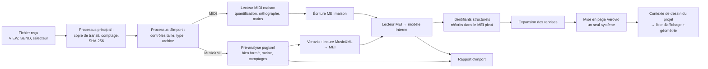

# 07 — Import et rendu de partition

Décisions : [ADR-0006](adr/0006-moteur-de-rendu-verovio.md) (Verovio), [ADR-0007](adr/0007-affichage-liste-d-affichage-compose.md) (liste d'affichage), [ADR-0008](adr/0008-modele-de-partition-et-format-pivot.md) (modèle et pivot), [ADR-0021](adr/0021-import-en-processus-isole.md) (processus d'import), [ADR-0023](adr/0023-deux-bibliotheques-natives.md) (deux bibliothèques). Toutes **proposées, à confirmer par POC-04**.

## 1. Vue d'ensemble



Tout ce qui lit le fichier non fiable s'exécute dans le **processus d'import**, qui charge `libpianoimport.so` ; le processus principal ne reçoit que des fichiers produits par le noyau (MEI pivot, liste d'affichage, rapport JSON) et ne charge jamais Verovio.

**Types reçus** (DA-17) : les URI `content://` n'ont pas d'extension fiable ; les filtres `VIEW` et `SEND` portent sur les types MIME `application/vnd.recordare.musicxml+xml`, `application/vnd.recordare.musicxml`, `audio/midi`, `audio/x-midi`, `application/xml`, `text/xml` et, pour les `.mxl` reçus sans type précis, `application/octet-stream` (l'application apparaîtrait alors pour tout fichier binaire : choix proposé au PO au [fichier 15](15-modifications-edb-prd-proposees.md)). Le contenu est contrôlé à l'import.

## 2. Import MusicXML

| Étape | Détail | Exigences |
|---|---|---|
| Contrôles préalables | Taille ≤ 20 Mio [ARCH] (comptée pendant la copie de transit) ; `.mxl` : répertoire central lu par miniz avant extraction, somme des tailles décompressées ≤ 64 Mio [ARCH], tailles réellement produites contrôlées pendant la décompression, 1 000 entrées au plus, chemins hors du dossier ignorés, fichier principal désigné par `META-INF/container.xml` | US-IMP-06 CA2 (valeurs figées par le PRD v0.4) à CA4, ENF-SEC-04 |
| Pré-analyse | pugixml 1.16 : document bien formé, racine `score-partwise` (`score-timewise` refusé avec un message au MVP), UTF-8 ou UTF-16 ; pugixml n'interprète pas la DTD [VÉRIFIÉ 2026-11-07, manuel pugixml] | US-IMP-01 CA1 et CA7, US-IMP-06 CA3 |
| Comptages indépendants | Comptage des éléments par catégorie sur l'arbre pugixml, comparé au modèle obtenu (analyseur indépendant de US-IMP-01 CA4) | EF-IMP-12 |
| Conversion | Verovio 6.4.1, compilé avec `NO_HUMDRUM_SUPPORT`, `NO_ABC_SUPPORT`, `NO_PAE_SUPPORT`, `NO_GABC_SUPPORT`, `NO_EDIT_SUPPORT` (DARMS et le moteur d'exécution sont déjà exclus par défaut) [VÉRIFIÉ par `dev-natif-cpp`, `cmake/CMakeLists.txt` de Verovio] ; le XML extrait est passé tel quel à Verovio | EF-IMP-01, ENF-RES-03 |
| Partie jouée | Première partie à deux portées, sinon la première ; les autres signalées | US-IMP-01 CA8 |
| Modèle | Lecteur MEI du noyau, identifiants structurels (§5) | RG-03 |
| Bornes | Mémoire comptée par les lecteurs et annulation coopérative (le noyau se borne lui-même, DN-30) ; filet de sécurité du processus d'import (minuterie interne de 5 s, plafond de mémoire à valider en POC-04) | US-IMP-06 CA3 |

## 3. Import MIDI

Verovio ne lit **pas** le MIDI [VÉRIFIÉ 2026-11-07]. L'import MIDI est maison :

| Étape | Détail | Exigences |
|---|---|---|
| Lecture | Types 0 et 1 ; type 2 et SMPTE refusés ; longueurs de blocs vérifiées ; nombre de pistes et d'événements bornés ; lecteur maison, ou midifile (BSD-2-Clause, déjà dans les sources de Verovio) | US-IMP-02 CA1 |
| Quantification | Grille déduite du tempo et du chiffrage ; 4/4 et ♩ = 120 par défaut, signalés « estimé » | US-IMP-02 CA2 |
| Mains | Deux pistes → une par portée ; une piste → point de séparation (E25) | US-IMP-02 CA3, CA4 |
| Orthographe | Annexe C de PED | US-IMP-02 CA6 |
| Écriture MEI | Sous-ensemble MEI produit par le noyau, puis même chemin que MusicXML | — |

## 4. Modèle interne

Le modèle (`score::Score`) reprend les entités de l'[EDB 09](../EDB/09-modele-de-donnees.md) : parties, portées, mesures (numéro affiché, rang, chiffrage, armure, reprises et fins), voix, événements (position en **fraction exacte**, durée, hauteur et orthographe, liaison, nature, doigté), indications de tempo et de caractère, indications d'octave. Aucune donnée de mise en page.

**Format pivot** : MEI produit par Verovio, avec les identifiants structurels ; le fichier source est gardé à côté (ENF-FIA-02). Le processus principal lit ce MEI avec le lecteur MEI du noyau (pugixml), sans Verovio.

## 5. Identifiants stables des notes

Les identifiants XML de Verovio (aléatoires, ou déterminés par `xmlIdSeed` ou `xmlIdChecksum`) dépendent de son implémentation. Le noyau les **remplace** par des identifiants **structurels** :

```
n.<partie>.<rang de mesure>.<portée>.<voix>.<rang d'événement>.<rang dans l'accord>
exemple : n.P1.m012.s1.v1.e03.c0
occurrence dans l'ordre de jeu : n.P1.m012.s1.v1.e03.c0~2  (2e passage d'une reprise)
```

Stables tant que le fichier n'est pas modifié et indépendants de la version de Verovio (RG-03) ; conservés dans le MEI pivot (`xml:id`) ; transmis par Verovio au contexte de dessin (`StartGraphic(…, gId)`), donc présents dans la liste d'affichage.

## 6. Rendu et mise en cache

| Point | Choix | Source |
|---|---|---|
| Moteur | Verovio 6.4.1, en natif (C++20), **dans le processus d'import seulement** | [VÉRIFIÉ 2026-11-07] |
| Mode bande | `breaks = none` (un seul système), `adjustPageWidth` | [VÉRIFIÉ 2026-11-07] `src/options.cpp` |
| Sortie | **Option D proposée** : `Toolkit::RenderToDeviceContext` (publique, non documentée) vers `DisplayListDeviceContext`, contexte de dessin du projet qui écrit la liste d'affichage : primitives à coordonnées entières, identifiants pris dans `gId`, glyphes SMuFL reçus par `DrawMusicText` et convertis **une fois** en chemins. Le SVG (`RenderToSVG`) sert d'**oracle** pour les tests de captures. À comparer à l'option A (conversion du SVG) en POC-04 | [VÉRIFIÉ par `dev-natif-cpp` le 2026-11-08, `include/vrv/toolkit.h`, `include/vrv/devicecontext.h`] ; [ADR-0007](adr/0007-affichage-liste-d-affichage-compose.md) |
| Données de Verovio | Verovio charge **toujours Bravura**, puis Leipzig, **par chemin de fichiers** [VÉRIFIÉ par `dev-natif-cpp`, `src/resources.cpp`] ; les `assets` d'un APK ne sont pas des fichiers : le dossier `data/` utile (Bravura, Leipzig, `text/`, environ 1 Mo) est extrait vers le stockage interne au premier import, avec un fichier de version (DN-24) ; seul le processus d'import en a besoin | — |
| Polices musicales | Fichiers **Leipzig et Bravura de Verovio, embarqués sans aucune modification**. Ce sont déjà des formes converties par leurs titulaires (au sens de l'OFL, une « Modified Version ») : leur redistribution à l'identique est défendable ; toute réduction ou reconversion par le projet demande une autorisation écrite, demandée seulement si la taille l'exige, après POC-04 (décision QO-53). `LICENSE.txt` et `FONTLOG.txt` de chaque police joints (JUR-D06) | [VÉRIFIÉ par `juriste-conformite` le 2026-11-07] |
| Police de texte (doigtés, numéros) | Pour Compose : un fichier TTF **d'origine**, non modifié, tiré d'une version publiée de Liberation (OFL-1.1, noms réservés Liberation, Arimo, Tinos, Cousine), ou une autre police OFL vérifiée à sa source ; les fichiers de texte de Verovio servent seulement aux métriques de mise en page (JUR-D07) | [VÉRIFIÉ par `juriste-conformite`] |
| Géométrie | Abscisses de début et de fin de chaque mesure, boîte de chaque note, abscisse de chaque instant d'attaque | US-VIS-01 |
| Coordonnées | Relatives à la tuile ou à la mesure ; décalage de tuile en `int64` (DN-23) | — |
| Cache | Calculé à l'import, par variante d'expansion, écrit dans `render/` | ENF-PERF-05 |

**Le zoom ne refait pas la mise en page.** En bande, la mise en page ne dépend pas de la largeur de l'écran : le zoom est une mise à l'échelle de la liste d'affichage ; la taille par défaut est calculée à partir de la densité physique (portée ≥ 7,6 mm sur téléphone, ≥ 8,9 mm sur tablette 10 pouces). EF-VIS-03 CA3 ne concerne que le mode page (V1) (INC-08).

**Dessin à 60 images/s** (DA-18) : chemins de glyphes construits une fois ; chaque tuile enregistrée dans un `GraphicsLayer` Compose (ou `RenderNode`) et redessinée seulement si son contenu change ; défilement et curseur par la lambda de `graphicsLayer` (phase de dessin) ; textes mis en forme une fois (`TextMeasurer`) ; aucun calque plus grand que la taille de texture maximale. Mesure en POC-04 par Macrobenchmark (`FrameTimingMetric`).

**Tests de captures** (US-VIS-01 CA4, DEV-13) : les images de référence sont **produites et comparées uniquement en CI** (Linux), soit par une construction hôte du dessin, soit par des captures sur l'émulateur la nuit si la liaison hôte est trop coûteuse ; choix fait en I1. Chaque mise à jour de Verovio passe un test de non-régression du contexte de dessin.

## 7. Bande horizontale et curseur

Mode du MVP : bande horizontale en paysage, qui avance par paliers (décision QO-27, provisoire).

| Règle | Mise en œuvre | Exigences |
|---|---|---|
| Ordre de jeu | Bande dessinée à partir de l'expansion, numéros d'origine, mention « 2e fois » | EF-VIS-05 CA3, US-VIS-05 CA2 |
| Paliers | Curseur entre 20 % et 60 % de la largeur ; décalage jusqu'à une barre en 250 à 300 ms | US-VIS-02 CA2 |
| Lecture en avance | Au moins une mesure entière et 4 temps après le curseur, à 150 % du tempo | EF-VIS-05 CA1 |
| Clé et armure | Marge gauche fixe | US-VIS-02 CA2 |
| Curseur | Calque séparé, placé à l'instant de présentation de l'image | EF-VIS-04 |
| Marges du système | Bande et commandes dans `WindowInsets.safeDrawing` (bord à bord, encoches) | DA-09 |

**Prototype du test au pupitre (QO-27).** Page HTML locale avec Verovio JavaScript (npm `verovio` 6.4.1, LGPL-3.0-only), construite avec Node.js. S'il est remis à d'autres personnes que le porteur, il est accompagné du texte de la LGPL et d'un lien vers les sources de Verovio (JUR-D13).

## 8. Surimpression des résultats

- Marques (US-RES-04 CA2) dessinées sur un **calque de résultats**, positionnées par la boîte de la note (identifiant structurel et occurrence).
- Note fausse dessinée à sa hauteur jouée (orthographe fournie par le noyau), tête pleine, sans changer la forme des têtes.
- Couleurs en jetons ; jamais la couleur seule (ENF-ACC-02).
- Colorer une note = mettre à jour une table identifiant → marque et redessiner le seul calque : ≤ 16 ms (critère de POC-04).

## 9. Rapport d'import

JSON de **codes** produit par le noyau : éléments ignorés, mesures incomplètes, sauts non pris en charge, choix automatiques, gravité. L'application le traduit en langage simple (US-IMP-05 CA5).
